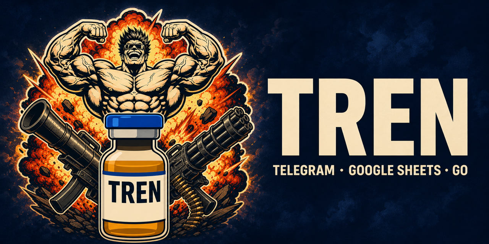
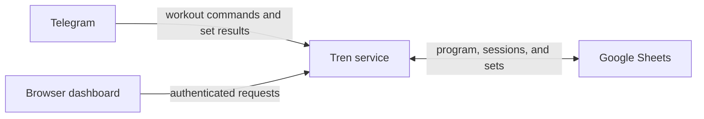

# Tren



[](https://github.com/eltonsst/tren/actions/workflows/ci.yml)

Tren is a self-hosted bodybuilding tracker built around Telegram, Google Sheets, and a Go web dashboard. Telegram handles workout logging, Sheets remains the editable source of truth, and the dashboard turns the recorded sets into exercise-level progress reports.

The name is a joke about trenbolone; the software tracks ordinary training data and does not provide drug guidance.

Tren deliberately uses a deterministic parser instead of an AI model. It requires no AI subscription, application database, or JavaScript toolchain.

## What it does

- Shows the next workout and the complete active A–D rotation in Telegram.
- Records working sets with load, reps, RIR, pain, and Telegram-level duplicate protection.
- Accepts partial workouts and advances only after an explicit `/finish`.
- Supports exercise-level and completed-workout undo flows.
- Creates the next program version after Workout D and applies deterministic progression rules.
- Keeps exercises, prescriptions, sessions, sets, and measurements editable in Google Sheets.
- Serves a responsive, password-protected exercise dashboard with progression charts.
- Runs locally with Telegram long polling or as one portable webhook-based container.



## Current scope

Tren currently supports one private Telegram user per deployment and a fixed A → B → C → D lifecycle. Exercise selection, order, prescriptions, aliases, and loads are editable in the Sheet. Arbitrary rotation lengths, additional chat providers, AI parsing, and in-chat substitutions are not implemented yet.

Only working sets are recorded. Photos are never stored.

## Quick start

### 1. Build Tren

Install the Go version declared in [`go.mod`](go.mod), then clone and build:

```bash
git clone https://github.com/eltonsst/tren.git
cd tren
go build -o ./dist/tren ./cmd/tren
```

Use `go run ./cmd/tren ...` in place of `./dist/tren ...` if you do not want to build a binary first.

### 2. Create the Google Sheet

Import [`docs/tren-data-contract.xlsx`](docs/tren-data-contract.xlsx) into Google Sheets and follow its **Start Here** tab. The included A–D program is example data and can be replaced with your own exercises and prescriptions.

Create a Google Cloud service account with the Google Sheets API enabled, download its JSON key, and share only the Tren Sheet with the service account's `client_email` as an Editor. Keep the JSON file outside this repository.

### 3. Create the Telegram bot

Create a bot with [`@BotFather`](https://t.me/BotFather) and keep its token in a private local file. Each installation should use its own bot, Sheet, and service account.

### 4. Configure and verify

```bash
./dist/tren setup
./dist/tren doctor
./dist/tren bot
```

Send `/whoami` to the bot, copy the returned numeric ID into `Config` → `authorized_telegram_user_id`, then send `/current`.

The complete local and hosted setup is documented in [`docs/onboarding.md`](docs/onboarding.md). Railway and provider-neutral Docker instructions are in [`docs/hosting.md`](docs/hosting.md).

## Logging a workout

Start the next workout with `/start`. Tren prompts for one exercise at a time and shows an example after every accepted result or parsing error.

```text
5@2 5@2 4@1 p0
```

Each set is `reps@RIR`; spaces, commas, and semicolons are accepted. The planned load is used automatically. Override it for the exercise with a prefix:

```text
75: 5@2 5@1 4@1
```

Use `75x5@2` when sets within the same exercise use different loads. Pain accepts `p0` through `p10`; omitting it is allowed but produces a warning rather than silently inventing a value.

Send `/undoexercise` to remove the latest exercise result in an open workout. Send `/finish` to save and advance even when exercises or sets are missing. After finishing, `/undo` permanently removes the latest completed workout and rewinds the rotation.

See [`docs/message-format.md`](docs/message-format.md) for the complete grammar.

## Commands

| Command | Purpose |
| --- | --- |
| `tren setup` | Create the private local configuration interactively |
| `tren doctor` | Validate configuration, credentials, Sheet access, schema, and Telegram identity |
| `tren bot` | Run the local long-polling Telegram bot |
| `tren serve` | Run the hosted webhook and dashboard service |
| `tren dashboard [exercise]` | Open the local browser dashboard |
| `tren stats [exercise]` | Print read-only exercise statistics |
| `tren check` | Validate the Google Sheets data contract |

Add `--demo` to `dashboard` or `stats` for synthetic offline data that never contacts Google Sheets.

The Telegram bot supports `/whoami`, `/current`, `/rotation`, `/start`, `/resume`, `/undoexercise`, `/finish`, `/undo`, `/howto`, and `/help`.

## Configuration

Local configuration defaults to `~/.config/tren/config.json`:

```json
{
  "spreadsheet_id": "your-google-spreadsheet-id",
  "google_credentials_file": "google-service-account.json",
  "telegram_token_file": "telegram-token",
  "dashboard_address": "127.0.0.1:8787"
}
```

Relative secret paths are resolved from the configuration directory. Environment-variable overrides and the hosted secret variables are listed in [`.env.example`](.env.example).

Hosted mode exposes:

- `GET /healthz`, a public endpoint that returns only `ok`;
- `/telegram/webhook`, protected by Telegram's secret-token header;
- all dashboard routes, protected with HTTP Basic authentication over the provider's HTTPS domain.

Google Sheets remains the only durable store. The container needs no volume or database.

## Program and progression

The Sheet addresses columns by header name, so columns may be reordered. Program versions become immutable when Workout A starts. Before that lock, the next rotation may be edited directly in `Program`: add or remove rows, change exercises, reorder positions, or adjust prescriptions.

Finishing Workout D creates the next version atomically. Loads increase only when all required sets reach the top of the rep range at the prescribed RIR without pain or substitutions. Historical prescriptions and completed sets are never rewritten by automatic progression.

The complete schema and lifecycle are documented in [`docs/data-contract.md`](docs/data-contract.md).

## Development

All automated tests use fakes or in-memory data and require no credentials:

```bash
make check
```

Individual commands are also available:

```bash
make fmt-check
make lint
make test
make test-race
make build
docker build -t tren:local .
```

GitHub Actions runs formatting and module-integrity checks, `go vet`, and race-enabled tests on Linux. The workflow receives read-only repository permissions and no deployment secrets.

The repository is maintained as a personal project and reference implementation. It does not currently operate as a contributor-driven project.

## License

Tren is available under the [MIT License](LICENSE).
